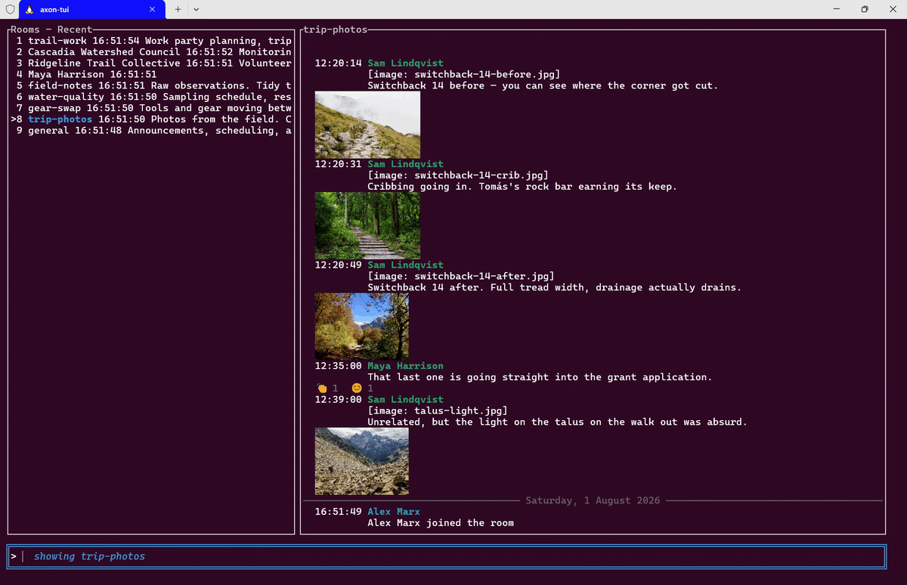
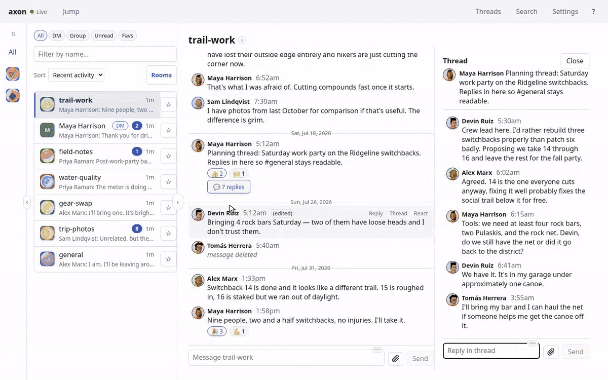

# Axon

Axon is a self-hosted personal agent for [Matrix](https://matrix.org).
It sits between your homeserver(s) and your clients, providing the persistent state, full-text search index, and per-device coherence that Matrix clients otherwise have to reinvent on every install.

Matrix's encrypted and decentralized architecture makes full client usability challenging.
This "middle" layer aims to solve that challenge.
It is similar to the [back-end for front-end](https://philcalcado.com/2015/09/18/the_back_end_for_front_end_pattern_bff.html) concept, with the added wrinkle that it is intended to run as a separate instance per user.
Old-timers may find a familiar with analogy with [ZNC Bouncer](https://en.wikipedia.org/wiki/ZNC), an agent that sits between an IRC client and an IRC server.

Axon differs from most clients by cleanly separating the end-user interface from the harder parts of the Matrix ecosystem: login (password/QR code), sync, E2EE device verification and message decryption, keys backup, and a full-history search index all live in Axon itself, not duplicated in every client — so a client can be wiped and reinstalled and be back to full functionality immediately, with no history to re-sync and no on-device index to rebuild.
That one persistent brain also covers multiple Matrix accounts (personal and work, even on different homeservers) under a single search index and open API, and resolves edits, reactions, and threads server-side so a late reaction to an old message is never silently dropped just because a client's timeline window has moved on.
Start composing a message on the mobile web app and continue that same draft instantly via the TUI on desktop.
No saving required.

Two reference clients consume that same open, versioned `/v1/` API today — [`axon-tui`](clients/tui/README.md), a keyboard-first full-featured terminal client with support for media, threads, and spaces, and [`axon-web`](clients/web/README.md), a desktop/mobile browser and [Tauri desktop client](clients/web/src-tauri/README.md).
Check out our [client parity](docs/client-parity.md) document for the current implementation status of these clients and future roadmap.
And because Axon can be self-hosted on your own hardware or cloud instance rather than a SaaS holding your decrypted history, it provides a single-command setup that works painlessly on Linux, MacOS, or Windows: a Docker Compose stack that brings up Postgres, Axon, and the web client behind one front door, with Caddy handling TLS and a Tailscale profile for private remote access already built in.

## Download

- [Latest release](https://github.com/matrix-axon/matrix-axon/releases/latest): includes Linux, MacOS, and Windows builds for server and both clients (desktop and terminal)
- [Full client/server Docker stack](#user-quick-start-with-docker)
- Get a recent iOS TestFlight beta build by posting in [#axon-developer:bostoncoop.net](https://matrix.to/#/%23axon-developer%3Abostoncoop.net) or install an older build [directly from the App Store](https://apps.apple.com/us/app/matrix-axon/id6813675186)
- [Android build](https://github.com/matrix-axon/matrix-axon/releases/latest/download/app-universal-release-signed.apk) (Play Store build coming soon, but we need testers for approval)
- Server, terminal client, and desktop app for MacOS via homebrew:

```sh
brew install matrix-axon/tap/axon-server
brew install matrix-axon/tap/axon-tui
brew install --cask matrix-axon/tap/axon
```

- Server with its web client on Debian 12 or Ubuntu 22.04 and newer (amd64 or arm64):

```sh
sudo apt install postgresql
curl -fLO "https://github.com/matrix-axon/matrix-axon/releases/latest/download/axon-server_$(dpkg --print-architecture).deb"
sudo apt install "./axon-server_$(dpkg --print-architecture).deb"
```

- Server with its web client on Fedora or RHEL 10 (x86_64 or aarch64):

```sh
sudo dnf install postgresql-server postgresql-contrib gawk
sudo postgresql-setup --initdb
sudo systemctl enable --now postgresql
curl -fLO "https://github.com/matrix-axon/matrix-axon/releases/latest/download/axon-server.$(uname -m).rpm"
sudo dnf install "./axon-server.$(uname -m).rpm"
```

Neither creates or starts a database when PostgreSQL is installed, so the second and third lines do that before the package goes on.
Skip `postgresql-setup --initdb` on a machine that already runs PostgreSQL.

On any of these systems, the install sets up the database and the service, then prints a one-time sign-in URL for the web client at `http://127.0.0.1:8080/`.
It listens on this machine only; the same output says how to reach it from other devices and how to turn the web client off.
`/usr/share/doc/axon-server/README.Debian` has the details.

## See it

[](https://matrix-axon.github.io/matrix-axon/demo.html#tui)

**[Watch the axon-tui demo](https://matrix-axon.github.io/matrix-axon/demo.html#tui)** (65s) — the room list, threads, inline photographs drawn as real terminal graphics, full-text search, and jump-to-date, all against a reproducible seeded world.

[](https://matrix-axon.github.io/matrix-axon/demo.html#web-desktop)

**[Watch the axon-web demos](https://matrix-axon.github.io/matrix-axon/demo.html#web-desktop)** — [desktop](https://matrix-axon.github.io/matrix-axon/demo.html#web-desktop) (101s): spaces, threads, image galleries with a lightbox, and search scoped, widened and narrowed again;
[mobile](https://matrix-axon.github.io/matrix-axon/demo.html#web-mobile) (62s) on an iPhone profile, where the single-pane layout makes the transitions the story.

Both clients read the same seeded world over the same `/v1/` API from the same live Axon.
The recordings live on the project site rather than inline here: GitHub renders repo-relative GIFs in a README but not MP4, and a GIF of any of these is both enormous and worse to look at.

Join our public discussion room [#axon-developer:bostoncoop.net](https://matrix.to/#/%23axon-developer%3Abostoncoop.net).

See [`docs/mvp/prd.md`](docs/mvp/prd.md) for a more complete product description, [`docs/mvp/tech-spec.md`](docs/mvp/tech-spec.md) for the architecture, and [https://matrix-axon.github.io/matrix-axon/api.html](https://matrix-axon.github.io/matrix-axon/api.html) for the latest OpenAPI specification.
Typed cached room-state details are available through the [room metadata API](docs/room-metadata.md), including advertised alternative aliases and creation, access, encryption, and power-level settings.
Room info also exposes cached SDK joined/invited counts independently of the partial member list, with unknown values until observed and a local observation timestamp.
Snapshots distinguish content availability from redaction evidence; legacy state without evidence remains unknown.
Web and TUI presentation of these additional details is tracked separately in that guide.

## User quick start with Docker

Run the full Axon stack — server **and** the web client — from prebuilt images, with **no clone and no build**.
Images are public, so no `docker login` or credentials required.

**Prereqs:** [Docker](https://www.docker.com/products/docker-desktop/)

```sh
# 1. Fetch the one-file Compose, then start it (images pull automatically)
curl -fsSL "https://raw.githubusercontent.com/matrix-axon/matrix-axon/refs/heads/main/deploy/docker-compose.beta.yml" \
  -o docker-compose.yml
docker compose up -d

# 2. Open the printed one-time setup URL in your browser (if installation hasn't yet finished, try again after a minute):
docker compose logs axon-server | grep 'bootstrap is armed'
```

Opening that `http://<host>:8080/bootstrap/<code>` URL mints your first credential and signs the web client in with nothing to paste.
Update later with `docker compose pull && docker compose up -d`;
stop with `docker compose down` (add `-v` to wipe data too).
For encrypted remote access, run `tailscale serve http://localhost:8080` on the host.
The build-from-source stack, TLS profiles, token management, and operations live in [`deploy/README.md`](deploy/README.md).

### TUI

This quick start can also drive the terminal client.
Download the latest [axon-tui](https://github.com/matrix-axon/matrix-axon/releases) for your platform, then point it at the same running stack — no repo needed, since the token comes from the container's own CLI:

```sh
# 1. Mint a token from the running stack:
docker compose exec axon-server axon-server token issue --label tui

# 2. Run the TUI against the front door, pasting that token:
axon-tui --base-url http://127.0.0.1:8080 --token <token>
```

The TUI reaches the API through the same `web` front door as the browser (use your `AXON_PORT` if you changed it).
The flags are the quickest path;
`axon-tui` also reads `AXON_BASE_URL` / `AXON_TOKEN`, or a `~/.config/axon-tui/config.toml` with a `[server]` block (`base_url` / `bearer_token`).
Note: minting a token creates a credential, which consumes the one-time web bootstrap if you haven't used it yet — so do the browser sign-in first if you want both the web client and the TUI.

### Desktop app

The same web client packaged as a native app — no browser tab, an OS-level window, and it remembers which server you use.
Download the current build for your platform from the [releases page](https://github.com/matrix-axon/matrix-axon/releases):

| Platform                      | File                            |
| ----------------------------- | ------------------------------- |
| macOS (Intel + Apple Silicon) | `Axon_<version>_universal.dmg`  |
| Windows (x64)                 | `Axon_<version>_x64-setup.exe`  |
| Debian / Ubuntu (x64)         | `Axon_<version>_amd64.deb`      |
| Other Linux (x64)             | `Axon_<version>_amd64.AppImage` |

On first launch it asks for your Axon server's address — `http://<host>:8080` for the Compose stack above, or your Tailscale or TLS hostname.
Then sign in with a token — `docker compose exec axon-server axon-server token issue --label desktop` — or through SSO, if your server has registered the desktop client (see [SSO sign-in](clients/web/README.md#sso-sign-in) for the `[[oauth.clients]]` entry it needs; the Compose stack does not create one for you).
The one-time `/bootstrap/<code>` URL from the Compose section above signs in the browser client, not the app, and minting a token consumes it — so do the browser sign-in first if you want both.
Each release also carries `THIRDPARTY-axon-desktop.txt`, the full license disclosure for everything the app bundles.

The macOS build is a universal binary, so Apple Silicon and Intel both run natively; the Windows and Linux builds are x64 only, so on ARM use the browser client or build the shell yourself ([#455](https://github.com/matrix-axon/matrix-axon/issues/455)).
The macOS build is signed with a Developer ID certificate and notarized by Apple, so it opens without a Gatekeeper warning.
The Windows executables and installer are signed through Azure Artifact Signing (ADR 0119), so they show a verified publisher; SmartScreen may still warn on the first downloads of a new release while its reputation builds.
The Linux builds are not signed, so some Linux desktops will warn the first time you run them.
Building the shell yourself is documented in [`clients/web/src-tauri/README.md`](clients/web/src-tauri/README.md).

## Architecture overview

```
Homeserver(s)  →  Axon (single binary)  →  axon-web (alpha client)
(Synapse /         sync · crypto · store      + any client built
 Dendrite)         search · media · api         against /v1/ API
```

One Rust binary, one Postgres database, media cached to local disk.
Personal and room image packs support emoji and sticker discovery; use the emoji-packs endpoint's `usage=sticker` mode for sticker-capable entries.
The `send-sticker` endpoint sends a standard `m.sticker` event with optional reply or thread relations; see [custom emoji and stickers](docs/custom-emoji.md).
The authenticated media download and thumbnail endpoints also resolve custom reaction images whose keys are `mxc://` URLs (MSC4027), without requiring an image pack definition.
Known left or banned rooms cannot authorize reaction image downloads.
Reaction media references must be structurally valid MXC URIs of at most 2,048 bytes; malformed and oversized keys do not authorize a fetch.
Reaction tallies also expose an optional `shortcode` from the original reaction content (`shortcode`, then `com.beeper.reaction.shortcode`).
Only custom MXC reactions with nonblank names of at most 100 UTF-8 bytes qualify.
C0 and C1 control characters are rejected, and surrounding whitespace is trimmed with an explicit ECMAScript-compatible character set; these rules do not depend on the database locale.
The oldest valid name by `(origin_ts, event_id)` among the existing capped, deduplicated reaction representatives wins; redaction removes that representative from consideration.
Each sender/key pair keeps its smallest-event-ID representative; a name on another duplicate is ignored until that representative is removed.
Names are omitted when unavailable, so clients should retain a generic fallback and render supplied names as untrusted text.
The room `emoji-packs` endpoint exposes cached personal and current-room custom emoji, and the media proxy accepts current pack references before their first use as reactions.
Reaction sends accept an optional `shortcode` alongside the unchanged MXC key; see [Custom emoji discovery](docs/custom-emoji.md) for sources, limits, and cache semantics.
Safe PNG, JPEG, GIF, and WebP signatures determine reaction image response types; unrecognized objects remain downloads with `application/octet-stream` and `nosniff`.
Media is fetched on client request and uses the existing per-object limit and globally bounded LRU cache.
The reaction index is built transactionally during startup, before this instance starts sync or serves requests; plan a maintenance restart for a large event store.
Displaying these images in Axon's reference clients is separate client work.
See the [architecture diagram](docs/mvp/tech-spec.md#architecture-overview) for detail.

## Clients

| Client                                            | Platform                                              | Status                                                                   |
| ------------------------------------------------- | ----------------------------------------------------- | ------------------------------------------------------------------------ |
| [`axon-tui`](clients/tui/README.md)               | Terminal                                              | Active (MVP reference client)                                            |
| [`axon-web`](clients/web/README.md)               | Web browser (desktop + mobile)                        | Active (nearing MVP)                                                     |
| [`axon-desktop`](clients/web/src-tauri/README.md) | Linux, macOS, Windows (Tauri shell around `axon-web`) | Active ([download](https://github.com/matrix-axon/matrix-axon/releases)) |
| `axon-mobile`                                     | iOS + Android (the same shell)                        | Planned (ADR 0102)                                                       |

See [ADR 0031](docs/adr/0031-client-strategy.md) for the client strategy and sequencing.

## Build it from source

Prerequisites are Rust (via rustup) and, if you don't already have Postgres running locally, Docker.

```bash
git clone https://github.com/matrix-axon/matrix-axon
cd matrix-axon
cargo run -p axon-server -- init   # generates a config + store_key, once
./run.sh                           # axon-server  (.\run.ps1 on Windows)
./run.sh tui                       # axon-tui
```

`run.sh` uses a local Postgres if one is already listening on `127.0.0.1:5432`, and otherwise starts one via Docker Compose, tearing down whatever it started on exit.

**Planning to send a pull request?**
[CONTRIBUTING.md](CONTRIBUTING.md) has the full prerequisite list (Node and pnpm for the web client, `pre-commit` for the push gate, jj), first-time setup, what the pre-push gate runs, and troubleshooting.

## Docs

|                                                   |                                                              |
| ------------------------------------------------- | ------------------------------------------------------------ |
| [CONTRIBUTING.md](CONTRIBUTING.md)                | Setup, the pre-push gate, and conventions                    |
| [PRD](docs/mvp/prd.md)                            | What we're building and why                                  |
| [Tech spec](docs/mvp/tech-spec.md)                | Architecture decisions                                       |
| [Implementation spec](docs/mvp/implementation.md) | Milestone-by-milestone build plan                            |
| [AGENTS.md](AGENTS.md)                            | Working conventions and current state, for humans and agents |
| [ADRs](docs/adr/)                                 | Decisions made during implementation                         |

## Database deadlines

Every server database connection has PostgreSQL statement and lock deadlines, including connections replaced after a request is canceled.
Ordinary statements default to 10 seconds, lock waits to 3 seconds, and pool acquisition to 5 seconds.
Hot timeline, media, and relation reads use a separate pool with `max_connections` slots.
Status and search indexing each reserve another connection, so a slow status query or bulk maintenance cannot block those reads or live indexing.
Status uses exact event totals maintained by database triggers instead of counting the event table on each request.
If its progress query fails, status still returns build, sync, management, and disk information, with `backfill.progress_available=false`.
Bulk maintenance shares another connection with a 120-second statement deadline; startup migrations and developer database repair use a 600-second statement and lock deadline.
Idle transactions are terminated after 30 seconds so an abandoned transaction cannot hold locks indefinitely.
These are per-statement deadlines, not a deadline for an entire multi-step operation.
A timed-out SQL statement fails and rolls back its writes; a canceled HTTP response does not prove that a write failed to commit.

Upgrades apply schema migrations at startup, before the server accepts requests.
A migration that adds a column or index to the `events` table holds it locked until the migration commits.
The thread-summary index (#763) took 96 seconds on a 2.7 GB `events` table, of which the backfill and the index build are separate statements under the 600-second deadline.
On a much larger database, raise `migration_statement_secs` for the upgrade if a statement times out; the failed migration rolls back and runs again at the next start.
A migration that rewrites many rows, as that one does, leaves index-only scans reading the table itself until autovacuum next processes it.
To get the faster plans at once, run `VACUUM (ANALYZE) events;` after the upgrade, or `VACUUM (PARALLEL 0, ANALYZE) events;` in a container whose `/dev/shm` is small (Docker's default is 64 MB).

Configure these values under `[database.timeouts]` in [axon.toml.example](axon.toml.example), or through overrides such as `AXON_DATABASE__TIMEOUTS__STATEMENT_SECS=20` and `AXON_DATABASE__TIMEOUTS__MAINTENANCE_STATEMENT_SECS=240`.
All deadlines must be between 1 and 86400 seconds; zero is rejected.
The statement deadlines must satisfy `statement_secs <= maintenance_statement_secs <= migration_statement_secs`.
Changes take effect after restarting the server.
On a slow machine, increase the relevant statement deadline while keeping lock and acquisition waits short enough to surface contention promptly.
The database must allow `2 * max_connections + 3` server connections, plus connections from CLI commands and other database users.
Short-lived token/OAuth commands verify one ordinary connection and open other pools only if needed; the server still verifies its entire budget before serving.

Account deletion and room purge commit event deletions in batches of at most 1000 rows, each with atomic search-cleanup obligations.
An interrupted account teardown retains its existing `deleting` breadcrumb for boot reconciliation; purge-on-leave queues a durable event watermark and wakes the supervised cleanup worker immediately, with retries every 30 seconds and after restart, without delaying sync on bulk deletion.
Wakeups schedule a bounded page of pending rooms; a backlog or slow maintenance operation can delay a particular room.
When purge-on-leave is enabled, ingestion skips events from rooms the SDK has marked left or banned, including the departure batch, so late callbacks cannot recreate purged data.
Each cleanup batch that deletes history also resets the history-backfill cursor atomically, allowing deleted history to be fetched again even after a rejoin.
Retries that delete no history preserve the current cursor.
Local leave state and its purge intent commit together, so an enqueue failure cannot leave a successfully saved leave without its cleanup obligation.
A later leave advances a pending watermark; retrying an earlier leave keeps its captured watermark so later rejoin events survive.
Retry pages rotate past persistent failures so the first 100 failing rooms cannot starve all later rooms.
Room cleanup removes only events captured by that watermark and enqueues per-event search removals, preserving later messages and rejoin metadata.
Room-summary rebuild remains transactional on the maintenance pool; account/session-wide pending-UTD scans use its longer deadline too.
Sync ingestion writes one event per statement; unread projections operate on one row per room; live search drains use indexed, limited outbox batches with ordinary deadlines.
Search-index seeding and outbox pruning use their own connection and the longer maintenance deadline.
Search-outbox pruning commits batches of at most 1000 rows so interruptions leave a safely retryable prefix.
Stale refresh-token cleanup runs in the background at most once per minute, with one sweep in flight across the server's store handles; cleanup failure does not reject token issuance or rotation.
Refresh tokens beyond the 30-day retention horizon are treated as unknown even if physical cleanup is delayed.
Session settings are initialized after connection, supporting direct PostgreSQL and session-mode poolers without a startup `options` parameter.
For PgBouncer, retain sqlx’s existing `ignore_startup_parameters = extra_float_digits` setting; ignoring `options` is unnecessary.
Transaction-mode poolers are unsupported: session deadlines and session advisory locks require a stable backend connection, as described in [PgBouncer’s feature matrix](https://www.pgbouncer.org/features.html).
See [ADR 0112](docs/adr/0112-bounded-database-work-and-pool-isolation.md) for the pool topology, transaction audit, and remaining maintenance tradeoffs.
Query and pool timeout failures use existing API error responses and request-error logging; cleanup failures log a redacted diagnostic category and retry on later activity.

## Environment variables

Two kinds of `AXON_`-prefixed environment variables exist:

**Standalone vars** — not tied to any config field, used by the CLI directly:

| Variable        | Used by                                    | Meaning                                                                                                                                                                                     |
| --------------- | ------------------------------------------ | ------------------------------------------------------------------------------------------------------------------------------------------------------------------------------------------- |
| `AXON_CONFIG`   | server, all CLI subcommands                | Path to the server config, when not passed via `--config`. Falls back to `./axon.toml`, then `~/.config/axon-server/config.toml` (with a read-only fallback to `~/.config/axon/axon.toml`). |
| `DATABASE_URL`  | server, all CLI subcommands                | Postgres connection string. Also settable as `AXON_DATABASE__URL` or `[database].url`.                                                                                                      |
| `AXON_BASE_URL` | `axon utd redecrypt` (HTTP CLI calls), TUI | Base URL of the running axon-server to call. **Defaults to `http://127.0.0.1:8080` — set explicitly for any non-local server.**                                                             |
| `AXON_TOKEN`    | `axon utd redecrypt`, TUI                  | Bearer token sent with the request, in place of `--token` (web does not consume token from env)                                                                                             |
| `RUST_LOG`      | server                                     | Overrides `log.level` / `AXON_LOG__LEVEL` with a raw `tracing` filter directive.                                                                                                            |

On Unix, config discovery ends with `/etc/axon-server/config.toml`, where the `.deb` and `.rpm` put the service's config, so `sudo -u axon axon-server token issue --label laptop` on a packaged install needs no `--config`.
A user's own file still wins over it.
When that file exists and the invoking user cannot read it, a command with no other configuration (no file, no `--config`, no `DATABASE_URL` or `AXON_*` variables) fails and says to run as the service's user; environment-only configuration and `axon-server init` are unaffected.

TUI-specific display vars (`AXON_FONT_SIZE`, `AXON_IMAGE_PROTOCOL`, `AXON_NO_IMAGE_QUERY`) are documented in [`clients/tui/README.md`](clients/tui/README.md).

**Structured config overrides** — every field in `axon.toml` can also be set via `AXON_<SECTION>__<FIELD>` (double underscore between nesting levels), e.g. `AXON_SERVER__PORT=9090` or `AXON_MEDIA__MAX_BYTES=1048576`.
Precedence (lowest to highest): built-in defaults < `axon.toml` < bare `DATABASE_URL` < `AXON_`-prefixed vars.

[`axon.toml.example`](axon.toml.example) is the full reference for every section and field, with the corresponding env var noted alongside each one.
[`.env.example`](.env.example) mirrors the same fields in env-var form for anyone who prefers configuring entirely through the environment.

## Deployment

### Authentication

All `/v1/` API endpoints require a bearer token.
Mint one after startup:

```bash
axon-server token issue --label my-client   # prints the raw token once
axon-server token list                       # list tokens (never shows secrets)
axon-server token revoke <id>                # revoke a token by id
axon-server token revoke --label my-client   # or by label, if it uniquely identifies one active token
```

Tokens are instance-scoped — one token grants access to all accounts on that Axon instance.
Revoking a token that belongs to a sign-in session (SSO) also signs out every session that client holds for the same identity, since the session could otherwise renew itself.
Supply the token to clients via their config file or environment;
see [`clients/tui/README.md`](clients/tui/README.md) for the TUI.

**OAuth / SSO sign-in (Google, Microsoft).**
Axon can also act as its own minimal OAuth 2.0 authorization server and OIDC relying party (ADR 0054), so the web client can sign in via SSO instead of pasting a bearer token.
This is separate from — and does not replace — the CLI token path above;
both mint the same kind of bearer token underneath.
Configure a provider (`oauth.providers.google` / `.microsoft` in `axon.toml`), then bind the owner's identity once from the command line:

```bash
axon-server oauth bind --provider google      # or --provider microsoft
axon-server oauth identities list
axon-server oauth identities unbind <id>       # atomically invalidates the identity's tokens and authorization codes
```

`bind` prints a URL — open it in any browser, on this machine or elsewhere, since it only needs to reach Axon's already-running `/v1/` surface — and polls until that browser leg completes or the 10-minute handshake expires.
Apple browser sign-in is implemented for deployments with their own registered Apple credentials; owner binding, web login, repeat login, and Google/Microsoft regression checks have been verified on a registered deployment.
Configure a Services ID (`client_id`), `team_id`, `key_id`, and exactly one of inline `private_key` or `private_key_path` under `[oauth.providers.apple]`, then set `enabled = true`.
Key files must be regular files of at most 16 KiB, with owner-only permissions on Unix (`chmod 600`); relative paths are resolved from the server/CLI working directory.
The callback is `oauth.external_base_url` (without trailing slashes) plus `/v1/oauth/apple/callback` and must be a canonical HTTPS URL without userinfo, query, or fragment.
Register that exact return URL with Apple; if `redirect_uri` is also configured, it must match exactly.
Use `axon-server oauth bind --provider apple` against the same configuration as the running server, or the explicitly armed first-run web bootstrap, to bind the owner before ordinary sign-in.
Cancellation ends the current attempt; restart sign-in or rerun the binding command to retry.
The iOS app signs in with Apple natively, which is a separate switch: `native_enabled = true` with `native_audiences = ["org.matrixaxon.axon"]` under `[oauth.providers.apple]`, needing no Services ID or key; no project signing key is distributed to self-hosters.
`enabled` is the browser flow only; for iOS-only Apple sign-in leave it `false`, since `enabled = true` without the browser credentials above stops startup.
The [native server contract](docs/apple-oauth-native.md) provides single-use challenges, owner-authorized binding, and atomic redemption; link an Apple ID from the app's Settings after signing in some other way.
See [ADR 0054's implementation addendum](docs/adr/0054-oauth-authorization-server.md#implementation-addendum-apple-rollout) for the remaining server and mobile work.
The [Apple browser verification guide](docs/apple-oauth-browser.md) covers configuration, automated checks, and the required registered-deployment acceptance pass.

**Remote push.**
A suspended iOS, iPadOS, or Android client registers a device token with `PUT /v1/push/registrations` and removes it with `DELETE /v1/push/registrations/{id}`.
The packaged iOS, iPadOS, and Android app registers when message notifications are on, and deletes that registration when they are turned off or the Axon session ends.
`GET /v1/status` reports `push.apns` and `push.fcm`, true when this process loaded that provider's key.
Registration succeeds when the key is not configured.
Waking a device is a separate step from storing the registration.
Set `[push.apns]` with `team_id`, `key_id`, `bundle_id`, and exactly one of `private_key` or `private_key_path`.
Set `[push.fcm]` with `project_id`, `client_email`, `package_name`, and exactly one of those key sources.
A provider whose every field is empty stays off.
A provider that is only partly set fails while the configuration is loading, before Axon contacts the database.
A key file that cannot be read, or a private key that is not that provider's key type, also stops startup.
Key files are regular files of at most 16 KiB, owner-only on Unix, same as the Apple sign-in key, and that sign-in key stays under `[oauth.providers.apple]`.
The environment names are `AXON_PUSH__APNS__PRIVATE_KEY`, `AXON_PUSH__APNS__PRIVATE_KEY_PATH`, `AXON_PUSH__FCM__PRIVATE_KEY`, and the same shape for the other fields.

The Matrix OAuth session foundation for Axon's own homeserver sessions is configured separately under `sync.matrix_oauth` (ADR 0097).
It dynamically registers a public client when the discovered authorization server permits it; operators can configure a static public client ID for issuers that disable dynamic registration.
Access and refresh tokens are encrypted with `sync.store_key`, and client secrets are not supported.
The authenticated QR acquisition API is available at `POST /v1/accounts/login/qr` and its flow-specific polling/input routes; it supports either displaying QR data or submitting a decoded scan and activates the account only after Axon independently confirms that its new device is cross-signed.
Browser sign-in (ADR 0117) is a third way to add an account on such a homeserver, for a user with no second Matrix client to scan with.
`POST /v1/accounts/login/browser` starts a flow for a Matrix user ID; the flow yields a link and a short code, the user opens the link in any browser on any device and approves, and the client polls `GET /v1/accounts/login/browser/{flow_id}` until it is `done`.
The link is valid for up to thirty minutes and is returned only while the flow waits for approval.
It needs a homeserver whose authorization server offers the OAuth device authorization grant, and reports `unsupported` otherwise.
An account added this way is signed in but its device is not verified; verify it afterwards with a recovery key or interactive verification.
The web client offers it on the Accounts page as **Sign in with browser**; the TUI does not yet.
[Browser sign-in](docs/matrix-oauth-browser-sign-in.md) lists the failure codes and how to diagnose a failed sign-in from the server log.
The web client exposes both QR presentations on its unified `/accounts` page, including camera or image scanning, check-code handling, authorization approval, cancellation, and reload resume.
The TUI presentation remains a later client-specific slice.
The existing password and token-import account routes remain available.

For first launch only, an interactive server can mint the first credential from the one-time `/bootstrap/<code>` URL printed at startup instead of requiring `axon token issue` in another shell.
The bootstrap page is loopback-only by default.
To allow a trusted remote browser during setup, set `server.bootstrap_web_allow_remote = true` (or `AXON_SERVER__BOOTSTRAP_WEB_ALLOW_REMOTE=true`) and make sure the server is fronted by TLS, a proxy, or a trusted network.
If `server.web_client_url` is set, the bootstrap success page links to that web client after showing the token;
the token is never placed in the URL.
A server that serves the web client itself (below) uses `/` when that key is unset.
Set the key when the web client is not at `/` of the address the operator's browser uses, for example behind a reverse proxy that publishes the server under a path prefix.

The bootstrap is offered only on an interactive TTY by default (the operator answers a prompt).
Headless or containerized deployments have no TTY, so they can arm it non-interactively with `server.bootstrap_web_auto = true` (`AXON_SERVER__BOOTSTRAP_WEB_AUTO=true`);
it still only arms when no credential exists yet, and the loopback / `bootstrap_web_allow_remote` gate is unchanged.
When `server.web_client_url` resolves to the **same origin** as the bootstrap page (e.g. a reverse proxy that serves the web client and proxies `/bootstrap` on one host), the bearer success page shows the freshly minted token with a "Copy token" button, and its "Open web client" button writes the token into the web client's `localStorage` and goes there — signing the operator in with nothing to paste, and still without the token ever appearing in a URL.
The page waits for that click because it is the only time the token is shown.
(This same-origin hand-off is bearer-token only; the SSO flow shows its tokens to copy.)

A binary built with the `embed-web` cargo feature carries the web client and serves it at every path that is not the API, on the same address and port (ADR 0116).
Build one with `pnpm --dir clients/web install && pnpm --dir clients/web build`, then `cargo build --release -p axon-server --features embed-web`;
Set `AXON_WEB_DIST` to the bundle's directory, as an absolute path, to make a missing bundle a build error: without it, an unbuilt `clients/web/dist` is only a cargo warning and the binary carries no web client.
The server's startup log says which it is.
The web client is reachable exactly where the API is, which is this machine only unless `server.host` says otherwise.
To serve the API alone, set `server.web_client = false` (or `AXON_SERVER__WEB_CLIENT=false`).
A binary built without the feature answers those paths with a page saying no web interface is served.

With `bootstrap_web_allow_remote = true`, any client that can reach the bootstrap surface — including one just probing it — shares the same six-wrong-URL lockout as the operator: six bad requests to `/bootstrap`, `/bootstrap/token`, `/bootstrap/oauth/{provider}`, or a wrong `/bootstrap/{code}` permanently close the bootstrap surface for the rest of the process, forcing a restart to try again.
This is an availability risk on top of the confidentiality one, so treat remote bootstrap as no safer than any other unauthenticated surface exposed off loopback.

To explicitly retry stored Unable-To-Decrypt events for an active account, call the authenticated API through the CLI wrapper:

```bash
AXON_TOKEN=<token> AXON_BASE_URL=<axon-server-url> axon utd redecrypt --account-id <account-id>
```

`AXON_BASE_URL` defaults to `http://127.0.0.1:8080` if unset — set it explicitly whenever the server isn't on localhost, or the request silently goes nowhere useful and fails with a 401 (the token is fine; it's just being checked against the wrong server).
See [Environment variables](#environment-variables) below for the full list of vars axon reads.

### Managing the server from a client

A signed-in client can administer the server through the management API under `/v1/management/` (ADR 0109), so the common jobs do not need a shell on the machine.
Today that is listing the sign-in identities linked to you, linking another and unlinking one, and listing, minting and revoking the tokens clients sign in with;
search-index rebuilds and the decryption backlog follow.
A minted token is shown once, in the response that creates it, exactly as `axon-server token issue` prints it once.

Changing credentials asks for more than being signed in.
The request must come from a token that never expires (one minted by `axon-server token issue`, `init` or the management API itself), or from a session that signed in with its provider in the last ten minutes;
otherwise the server answers `recent_sign_in_required` and the client signs you in again.
Removing the last way to sign in is refused until you confirm it.

It is on by default.
To keep these operations behind the command line, set `server.management_api = false` (or `AXON_SERVER__MANAGEMENT_API=false`): every management route then answers `403`, and the `axon-server` subcommands keep working.

### TLS

Axon serves plain HTTP.
For any non-local deployment, place a TLS-terminating reverse proxy (Caddy, nginx, etc.) in front of it and keep Axon bound to loopback (the default).
Axon refuses to start on a non-loopback address over plain HTTP unless `AXON_SERVER__ALLOW_INSECURE_BIND=true` is explicitly set.
The `caddy` profile in the full `deploy/` stack automates this — see [deploy/README.md](deploy/README.md).

### Support

Need help? Join [`#axon-support:bostoncoop.net`](https://matrix.to/#/#axon-support:bostoncoop.net) on Matrix, ask in [GitHub Discussions](https://github.com/matrix-axon/matrix-axon/discussions), or report a bug in [GitHub Issues](https://github.com/matrix-axon/matrix-axon/issues).
Developer discussion happens in [`#axon-developer:bostoncoop.net`](https://matrix.to/#/#axon-developer:bostoncoop.net).
The full list of options, including email, is on the [support page](https://matrix-axon.github.io/matrix-axon/support/).

### Privacy Policy

Axon does not collect, store, transmit, or share any personal information, usage data, or analytics on behalf of its developer. This app is a client for a self-hosted Axon server that you (or someone you trust) run and control. All of your data — messages, media, contacts, and account credentials — is exchanged directly between this app and the Axon server address you configure. The developer of this app has no server, database, or analytics service that receives your data, and no ability to access it.

Read the full [privacy policy](https://matrix-axon.github.io/matrix-axon/privacy/).

### Third-Party Open Source Components

This project uses several third-party open-source components, described in [THIRDPARTY.md](THIRDPARTY.md).
We are grateful to those developers for making this software possible.
